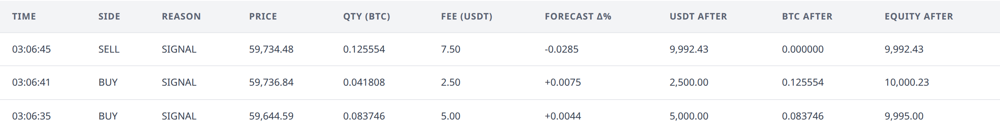

# ITD105 Lab: LSTM Crypto Trading Bot (BTC/USDT)

## Project Overview
This project extends the course reference app [msuiit-ph/BZUI-LSTM-BTCUSDT](https://github.com/msuiit-ph/BZUI-LSTM-BTCUSDT) (a browser-only BTC/USDT forecaster built with a hand-written single-cell **LSTM** and the bzUI component library) into an automated **paper-trading bot**. Every time a new closed candle arrives, the LSTM forecasts the next price, the bot turns the forecast into a **BUY / SELL / HOLD** decision using a percentage threshold, and a simulated order is executed against an **in-code dummy wallet** (virtual USDT and BTC held in JavaScript state). The page shows the wallet, equity, PnL, a Start/Stop/Reset control set and a live trade table next to the original forecast chart and LSTM network visualizations.

**Safety statement.** No exchange account, testnet account, API key or real funds are used or required. The only network call is the public, keyless `https://api.binance.com/api/v3/klines` market-data endpoint that the reference app already used. No order, account or authenticated endpoint is ever called; all trades exist only as numbers in the browser.

## What the App Wants to Find Out
Can a tiny LSTM trained online on the last few hundred 1-second or 1-minute BTC/USDT candles produce forecasts good enough to trade on after fees? The app measures this directly: the bot's equity is compared with a **buy-and-hold benchmark**, and the forecast quality is compared with a **repeat-last-close baseline** (MAPE of the LSTM vs MAPE of "the next price equals the last close"). An optional **MAPE gate** can hold the bot out of the market whenever the LSTM is not beating that baseline.

## Dummy Account & Trading Strategy

**Wallet (`wallet.js`).** A wallet is a plain object `{ usdt, btc, initialUsdt, avgEntry, feesPaid }` starting at **10,000.00 USDT and 0 BTC**. Pure functions (`executeBuy`, `executeSell`, `equity`, `pnl`, `positionOf`) return a new wallet, so the logic is unit-testable. Equity = `usdt + btc * price`; PnL = equity minus the initial balance; position is `BTC` when the holding is worth at least 1 USDT, otherwise `CASH`. Balances are rounded to 8 decimals, selling 100% leaves `btc === 0` exactly, and Reset restores the initial wallet.

**Signal (`trading-bot.js`).** On each newly closed candle:

```
changePct = (forecast[0] / lastClose - 1) * 100      // next-candle forecast vs latest closed candle
BUY   if changePct >  +threshold  and free USDT * buy%  >= 10 USDT
SELL  if changePct <  -threshold  and BTC * sell% * price >= 10 USDT
HOLD  otherwise
```

**Adaptive threshold (default).** On 1-second candles the forecast change is tiny: over a 150 s measurement `|changePct|` had p50 0.0010%, p75 0.0018%, p90 0.0038%, p95 0.0046% and a maximum of 0.0068%, so a fixed 0.01% never fires and no single fixed value holds a steady trade rate while volatility drifts. In *adaptive* mode the threshold `theta` is steered by a **feedback controller on the bot's actual trades** (a multiplicative stochastic-approximation update), so that about `target` trades per minute happen:

```
candlesPerMinute = 60000 / intervalMs                    // 1s -> 60, 1m -> 1
p                = min(1, targetTradesPerMin / candlesPerMinute)
warm-up          : the first 20 evaluated candles use the fixed threshold and collect |changePct|
init             : theta = p90 of the 20 samples (sorted ascending, index floor(0.9 * n)), or the fixed threshold if that is 0
every candle     : decide with theta (BUY if changePct > theta, SELL if < -theta, same position and dust rules)
                   traded = 1 if the candle produced any trade (SIGNAL, STOP_LOSS or TAKE_PROFIT), else 0
                   theta  = clamp(theta * exp(0.3 * (traded - p)), 0.00001 %, 1 %)
```

A trade raises theta (fewer trades follow), a candle without a trade lowers it slightly, and the two balance where the trade probability per candle equals `p`. It targets *trades* rather than *signals* because a signal is only a trade when the wallet allows it (a SELL signal while holding no BTC is a HOLD, and a BUY is skipped once the free USDT is dust), so a signal-based percentile cannot hold a trade rate; feeding back the real outcome absorbs those effects and any drift in forecast scale or bias. While warming up the live readout says "warming up n/20, using fixed". Changing the timeframe or pressing Reset clears theta and the samples and goes back to warm-up. In *fixed* mode the controller is ignored.

Orders execute at the latest closed candle price. BUY spends a percentage of free USDT, SELL sells a percentage of held BTC. The 10 USDT minimum order prevents dust orders after repeated 50% buys. A candle is evaluated once (keyed by its open time), even though `tick()` runs every second.

**Chosen parameters (all shipped defaults; threshold and sizing are editable in the UI):**

| Parameter | Value used | Purpose & behavior |
|---|---|---|
| SYMBOL | `BTCUSDT` | Spot pair fetched from the public klines endpoint |
| INTERVAL | `1s` default in the app (the test run below used `1s`) | Candle interval; shorter intervals give faster closed-candle trades |
| WINDOW / HORIZON | 20 candles / 20 steps | Past closed candles fed to the LSTM / future steps projected (the trade signal uses step 1) |
| EPOCHS_PER_CANDLE / LR | 30 epochs / 0.005 | BPTT passes and learning rate run on every new closed candle |
| Initial dummy balance | 10,000.00 USDT, 0 BTC | Starting virtual capital |
| Threshold mode | adaptive | Feedback controller on the trade rate instead of a fixed value |
| Target trades/min | 3 | Sets `p = min(1, 3 / candlesPerMinute)` = 0.05 per candle on 1s candles |
| Warm-up / init | 20 candles / p90 of the samples | The first 20 candles use the fixed threshold and collect `|changePct|`; theta then starts at their p90 |
| Controller gain / bounds | eta 0.3 / theta in [0.00001%, 1%] | `theta = clamp(theta * exp(0.3 * (traded - p)))` after each candle |
| Fixed threshold | 0.01% | Used in fixed mode and as the warm-up fallback |
| Trade size | BUY 50% of free USDT, SELL 100% of held BTC | Fixed-percentage order sizing |
| Fee | 0.1% per order | Simulated taker fee, charged on every BUY and SELL |
| Stop-loss / Take-profit | 0.5% / 0.5% from the average entry price (0 = off) | Risk exits checked each closed candle before the LSTM signal |
| MAPE gate | off | When on, BUY/SELL becomes HOLD while LSTM MAPE >= baseline MAPE |
| Minimum order | 10 USDT | Smaller orders are skipped (HOLD) |

## How to Run

Requires a modern browser and internet access (market data and the bzUI library are loaded from public CDNs). No build step.

```bash
git clone <this-repository-url>
cd <repository>/lstm-trading-bot
python3 -m http.server 8000
```

Then open <http://localhost:8000> (or open the folder with the VS Code *Live Server* extension). Wait until the green "Live" dot appears, pick a timeframe (for example `1s` or `1m`), optionally adjust the bot settings, and press **Start**. Trades appear in the table as closed candles trigger signals; **Stop** pauses the bot, **Reset** restores 10,000 USDT / 0 BTC, **Export CSV** downloads the trade history.

Unit tests (Node 22+, no dependencies to install):

```bash
npm test
```

This runs `node --test tests/*.test.js` (57 tests covering the wallet, signal and adaptive-threshold logic, fees, risk exits, MAPE gate, input validation, persistence and CSV export).

## Test Results & Screenshots

The screenshots were produced by an automated headless Chromium run (fresh browser profile, 1400 px wide, 2x pixel ratio) while the bot was **Running**. The three images were captured back-to-back with no trade in between. The initial-state image (bot card before pressing Start: 10,000.00 USDT, 0 BTC) is `0_Initial.png` in the same folder and shown at the end of this section. Readouts such as buy-and-hold and MAPE update every second, so numbers quoted below are those visible in the images.

<table>
  <tr>
    <td align="center"><br><b>1. Dummy Account &amp; Portfolio Summary</b></td>
  </tr>
  <tr>
    <td align="center"><br><b>2. Simulated Trade Execution Log</b></td>
  </tr>
  <tr>
    <td align="center"><br><b>3. LSTM Forecast Chart &amp; Network Visualizations</b></td>
  </tr>
</table>

Initial state: 

**Setup.** The run used the shipped defaults with no override: **adaptive** threshold mode, target **3 trades/min**, fixed fallback 0.01%, the **1s** timeframe, 300 candles, window 20, buy 50%, sell 100%, fee 0.1%, SL 0.5%, TP 0.5%, MAPE gate off. The bot was started at 03:05:33 (UTC) and the screenshots were taken at about 03:07:03, after 1 min 30 s of running; the first BUY filled on the 03:06:35 candle, the second BUY at 03:06:41 and the SELL at 03:06:45. The unrolled graph in screenshot 3 was captured well after page load, once the layout had settled. The readout in screenshot 1 reads "Threshold: 0.0052% (adaptive, target 3 trades/min)": the controller's current theta was 0.0052%.

**Trade rate.** The screenshot run produced **3 trades in the first 1.5 minutes (about 2.0 trades/min)**. Two separate 3-minute acceptance runs at the same defaults gave **10 trades (4, 3 and 3 per minute, 3.33/min)** and **9 trades (4, 4 and 1 per minute, 3.00/min)**, with no console errors. The first percentile-based version of the adaptive threshold only managed about 0.8 trades/min pooled over four runs (0, 6, 2 and 2 trades); see change 14. A seeded 3,600-candle simulation in the unit tests also holds 3.0 trades/min over the last 50 minutes.

**Trades (newest first; time = candle close, UTC):**

| Time | Side | Reason | Price | Qty (BTC) | Fee (USDT) | Forecast Δ% | USDT after | BTC after | Equity after |
|---|---|---|---|---|---|---|---|---|---|
| 03:06:45 | SELL | SIGNAL | 59,734.48 | 0.125554 | 7.50 | -0.0285 | 9,992.43 | 0.000000 | 9,992.43 |
| 03:06:41 | BUY | SIGNAL | 59,736.84 | 0.041808 | 2.50 | +0.0075 | 2,500.00 | 0.125554 | 10,000.23 |
| 03:06:35 | BUY | SIGNAL | 59,644.59 | 0.083746 | 5.00 | +0.0044 | 5,000.00 | 0.083746 | 9,995.00 |

**Final readouts (as in the screenshots).** Status Running, USDT 9,992.43, BTC 0.000000, position CASH, equity **9,992.43**, PnL **-7.57 USDT (-0.0757%)**, last signal HOLD (-0.0024%), threshold 0.0052% (adaptive, target 3 trades/min). Fees paid: 5.00 + 2.50 + 7.50 = **15.00 USDT**. The buy-and-hold benchmark stood at 9,967.23 USDT (**-32.77 USDT, -0.3277%**), so the bot was ahead of buy-and-hold by about 25.20 USDT. Over 93 predicted candles the LSTM MAPE was **0.031%** against **0.025%** for the repeat-last-close baseline. Last close 59,867.21 USDT.

**Analysis.**
- The bot is mechanically correct: the first BUY spent 50% of the free USDT (5,000.00, fee 5.00), the second BUY 50% of the remainder (2,500.00, fee 2.50), and the SELL emptied the 0.125554 BTC holding exactly to 0 and paid a 0.1% fee on the proceeds (7.50). Equity after the first BUY is 9,995.00 (the entry fee).
- Price effect on the trades: the first BUY (0.083746 BTC) was sold 89.89 USDT per BTC higher (59,644.59 to 59,734.48), a gain of 7.53 USDT; the second BUY (0.041808 BTC) was sold 2.36 USDT per BTC lower, a loss of 0.10 USDT. The net price gain of 7.43 USDT is smaller than the fees of 15.00 USDT, which gives the PnL of -7.57 USDT. The trades were triggered by forecast deltas of +0.0044%, +0.0075% and -0.0285%, tiny against the 0.2% cost of a round trip at a 0.1% fee: the adaptive threshold controls how often the bot trades, not whether a trade is profitable, and a round trip only pays when the price happens to move by more than about 0.2% (here the 0.15% rise in 10 seconds was caught by the first BUY but still lost to fees).
- The equity chart shows the bot line flat at 0 until the first BUY, because an all-cash wallet has constant equity, then following the BTC price while invested and flat again after the SELL. The bot beat buy-and-hold mainly because it sat in cash while BTC fell by about 0.3% earlier in the run; this is the direction of the market, not evidence of skill. A single three-trade run is not statistical evidence either way.
- **Honest assessment of the model.** The LSTM is a single cell with 14 trainable parameters, trained online for 30 epochs on a few hundred 1-second or 1-minute returns. Its MAPE (0.031%) is *worse* than the trivial "next price = last close" baseline (0.025%), and the same pattern appeared in every other accuracy check taken during development (for example 0.011% vs 0.008%, 0.007% vs 0.004%, 0.004% vs 0.003%). At these horizons price changes are close to a random walk, so a forecast that does not beat the naive baseline carries no exploitable information; the 20-step forecast curve at the right of the price chart (a flat-to-down extrapolation to 59,863.88) is an extrapolation of recent noise, and the BUY/SELL signals are essentially noise crossing a threshold that the controller keeps lowering until about 3 trades per minute happen. A fixed 0.01% threshold would have kept the bot in HOLD (see the change list below), which would have avoided fees but also produced no trades to evaluate. Enabling the **MAPE gate** would have kept the bot out of the market in this run, because the LSTM did not beat the baseline. This is an educational demo, not a trading signal.

## Changes from the Provided Source Code & Why

The five reference files (`index.html`, `app.js`, `tiny-lstm.js`, `unroll-graph.js`, `LICENSE`) were first committed unmodified, so `git diff` shows exactly what was changed. The LSTM math in `tiny-lstm.js` was not touched; `unroll-graph.js` received only the small layout fix listed as change 11. Reference files keep their 2-space indentation; new files use 4 spaces.

1. **`app.js` (fix): live indicator never turned on**
   * **Change**: In `tick()`, after a successful update, added `liveEl.dataset.state = 'on'`.
   * **Why**: The CSS defines a pulsing green state for `#live-dot[data-state="on"]`, but the reference code only ever set `error`, so the dot stayed grey ("idle") even while live data streamed in, and it also never recovered from `error`. Setting `on` after each success fixes both.

2. **`wallet.js` (new): in-code dummy account**
   * **Change**: Pure functions to create a wallet, execute BUY/SELL with fee, compute equity, PnL and position; 8-decimal rounding; selling the full holding sets BTC to exactly 0; invalid orders throw.
   * **Why**: Required virtual wallet (USDT, BTC, position, equity, PnL). Keeping it pure and free of I/O makes balance conservation and rounding unit-testable and guarantees no exchange code exists.

3. **`trading-bot.js` (new): signal generation and simulated execution**
   * **Change**: `expectedChangePct`, `decideSignal`, `parseBotConfig` and `createBot` (Start/Stop/Reset, dedup by candle open time, trade history with timestamp, side, price, quantity, forecast change and balances after).
   * **Why**: Turns the forecast into BUY/SELL/HOLD with the threshold rule from the lab, executes at the latest closed candle price, and protects against dust orders, duplicate evaluation of the same candle, and invalid threshold/size inputs (rejected, previous value kept).

4. **`bot-ui.js` (new) and `index.html` (modified): controls and live readouts**
   * **Change**: A "Paper-trading bot" card in the existing bzUI card style with initial and current balances, equity, PnL, position, last signal, Running/Stopped status, Start/Stop/Reset, editable settings and a live trade table. Rows are built with `textContent` only.
   * **Why**: Required user interface. Placed between the chart and the network cards so the forecast views remain on the same page.

5. **`app.js` (modified): integration hooks**
   * **Change**: Imports for the bot modules, bot and panel creation after the graph is built, and a call in `tick()` that passes the newest closed candle, `forecast[0]` and the accuracy numbers to the bot. `updateAccuracy()` now returns `{ mape, baseMape }` (or `null`). Bot exceptions are caught in `runBot()` and shown in the panel so they never stop the chart from rendering.
   * **Why**: Reuses the reference `trainAndForecast()` pipeline as the lab requires instead of duplicating it, with minimal edits to a reference file.

6. **`package.json`, `tests/*.test.js`, `.gitignore` (new): verification**
   * **Change**: `npm test` runs the Node test runner over 57 tests (wallet, bot, storage, CSV); `.gitignore` excludes `node_modules/`.
   * **Why**: Proves the wallet and signal rules (dust, invalid input, duplicate candles, exact-zero sell, corrupt storage) without a browser.

### Innovations (beyond the lab requirements)

7. **Fees and buy-and-hold benchmark (`wallet.js`, `trading-bot.js`, `bot-ui.js`, `index.html`)**
   * **Change**: Configurable per-order fee (default 0.1%), cumulative fees paid, and a benchmark that buys with all initial USDT when the bot starts and is valued at each price.
   * **Why**: A bot that ignores fees looks better than it is; the benchmark answers whether trading beat doing nothing.

8. **Stop-loss / take-profit and MAPE gate (`trading-bot.js`, `bot-ui.js`, `index.html`)**
   * **Change**: Risk exits (default 0.5% / 0.5% from average entry, 0 = off) checked before the LSTM signal, and an optional gate turning trades into HOLD while LSTM MAPE >= repeat-last-close MAPE. Trades record a reason (`SIGNAL`, `STOP_LOSS`, `TAKE_PROFIT`).
   * **Why**: Limits losses on a noisy signal, and uses the app's own accuracy check to avoid trading when the model is no better than the naive baseline.

9. **Equity chart and trade markers (`app.js`, `bot-ui.js`, `index.html`)**
   * **Change**: An equity-change-vs-initial line chart (bot and buy-and-hold) and BUY/SELL text markers on the price chart.
   * **Why**: Makes the performance comparison and the timing of orders visible at a glance.

10. **Persistence and CSV export (`storage.js`, `csv.js`, `bot-ui.js`, `app.js`)**
    * **Change**: Bot state is saved to `localStorage` (restored stopped; corrupt, tampered or old data loads as a fresh wallet without an exception), and the trade history exports as `trades.csv` with a spreadsheet-formula-safe cell encoder.
    * **Why**: Runs survive a page reload and the history can be analyzed or attached outside the app, while treating stored and exported data as untrusted.

### Fixes after testing

11. **`unroll-graph.js` (fix): unrolled graph drifted left and was clipped**
    * **Change**: Nodes are now seeded centred on the origin (x minus half the chain width), the view is re-fitted every frame while the layout is still settling (unless the user panned, zoomed or reset), and the fit leaves a wider horizontal margin for node labels.
    * **Why**: The chain was seeded at x = 0 to 3000 while the gravity force pulls toward x = 0, and every update re-heated the simulation, so the whole graph slid about 1,460 units left under a view that was fitted only once, clipping the left edge. Centred seeding removes the net pull and the continuous fit keeps the graph in frame.

12. **`bot-ui.js` / `index.html` (fix): Start/Stop button states**
    * **Change**: In `render()`, Start is disabled while the bot is running and Stop is disabled while it is stopped; `render()` runs at panel creation, so the state is correct on load and after restoring from `localStorage`.
    * **Why**: Prevents a double Start and makes the current state obvious; a disabled button ignores clicks.

13. **`bot-ui.js` / `index.html` (fix): "No trades yet" message**
    * **Change**: A message below the trade table is shown while the trade list is empty and hidden after the first trade (set with `hidden`, no HTML injection).
    * **Why**: With no trades the wallet is all cash, so equity is constant and the equity chart is a flat 0 line; the message explains that this is expected until the forecast change crosses the threshold.

### Adaptive threshold

14. **`trading-bot.js`, `storage.js`, `bot-ui.js`, `index.html`, `app.js` (change): adaptive threshold with a trade-rate feedback controller**
    * **Change**: A new default threshold mode. After a 20-candle warm-up on the fixed threshold, theta starts at the p90 of the collected `|changePct|` values and is then updated after every candle by `theta = clamp(theta * exp(0.3 * (traded - p)), 0.00001%, 1%)`, where `traded` is 1 when the candle produced any trade (signal, stop-loss or take-profit) and `p = min(1, targetTradesPerMin / candlesPerMinute)`. Theta, the warm-up samples and the interval are persisted and cleared on a timeframe change and on Reset. The panel gains a mode selector, a "Target trades/min" input, the renamed "Fixed threshold (%)" input and a live "Threshold: ..." readout. `app.js` passes `intervalMs` to the bot (one line), and `unroll-graph.js` raises the vertical fit margin from 40 to 80 so the lowest label of the unrolled graph is no longer clipped.
    * **Why**: Measured over 150 s on 1s candles, `|changePct|` had p50 0.0010%, p75 0.0018%, p90 0.0038%, p95 0.0046% and a maximum of 0.0068%, so the fixed default of 0.01% never fires, and no single fixed value holds a steady rate because the volatility drifts. A first version used the rolling 95th percentile of the last 60 values (target 3 signals/min) and fell short: pooled over four 3-minute runs it made only 0.8 trades/min (0, 6, 2 and 2 trades). Causes: the quantile index `floor(0.95 * 60) = 57` leaves only 2 of 60 samples above the threshold, so it aimed at about 2 signals/min rather than 3 (measured: 5 exceedances in 148 candles); exceedances come in bursts because the forecast change is autocorrelated; and a signal is not a trade (a SELL signal without BTC is a HOLD, and a BUY is skipped once USDT is dust). Steering theta from the bot's actual trades removes all three effects. With it, two 3-minute runs at the shipped defaults gave 3.33 and 3.00 trades/min.
