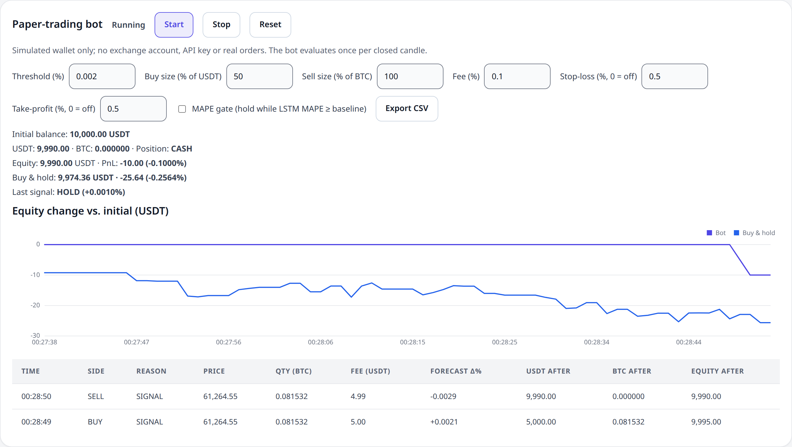
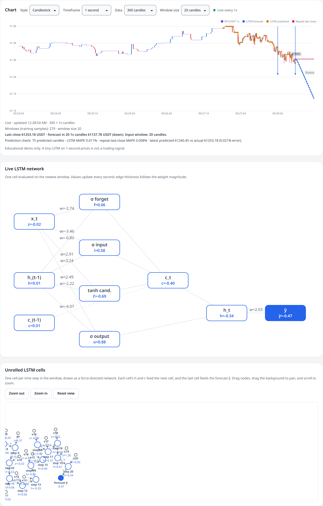
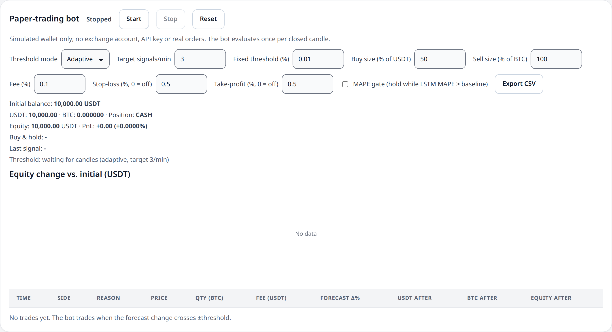

# ITD105 Lab: LSTM Crypto Trading Bot (BTC/USDT)

## Project Overview
This project extends the course reference app [msuiit-ph/BZUI-LSTM-BTCUSDT](https://github.com/msuiit-ph/BZUI-LSTM-BTCUSDT) (a browser-only BTC/USDT forecaster built with a hand-written single-cell **LSTM** and the bzUI component library) into an automated **paper-trading bot**. Every time a new closed candle arrives, the LSTM forecasts the next price, the bot turns the forecast into a **BUY / SELL / HOLD** decision using a percentage threshold, and a simulated order is executed against an **in-code dummy wallet** (virtual USDT and BTC held in JavaScript state). The page shows the wallet, equity, PnL, a Start/Stop/Reset control set and a live trade table next to the original forecast chart and LSTM network visualizations.

**Safety statement.** No exchange account, testnet account, API key or real funds are used or required. The only network call is the public, keyless `https://api.binance.com/api/v3/klines` market-data endpoint that the reference app already used. No order, account or authenticated endpoint is ever called; all trades exist only as numbers in the browser.

## What the App Wants to Find Out
Can a tiny LSTM trained online on the last few hundred 1-second or 1-minute BTC/USDT candles produce forecasts good enough to trade on after fees? The app measures this directly: the bot's equity is compared with a **buy-and-hold benchmark**, and the forecast quality is compared with a **repeat-last-close baseline** (MAPE of the LSTM vs MAPE of "the next price equals the last close"). An optional **MAPE gate** can hold the bot out of the market whenever the LSTM is not beating that baseline.

## Dummy Account & Trading Strategy

**Wallet (`wallet.js`).** A wallet is a plain object `{ usdt, btc, initialUsdt, avgEntry, feesPaid }` starting at **10,000.00 USDT and 0 BTC**. Pure functions (`executeBuy`, `executeSell`, `equity`, `pnl`, `positionOf`) return a new wallet, so the logic is unit-testable. Equity = `usdt + btc * price`; PnL = equity minus the initial balance; position is `BTC` when the holding is worth at least 1 USDT, otherwise `CASH`. Balances are rounded to 8 decimals, selling 100% leaves `btc === 0` exactly, and Reset restores the initial wallet.

**Signal (`trading-bot.js`).** On each newly closed candle:

```
changePct = (forecast[0] / lastClose - 1) * 100      // next-candle forecast vs latest closed candle
BUY   if changePct >  +threshold  and free USDT * buy%  >= 10 USDT
SELL  if changePct <  -threshold  and BTC * sell% * price >= 10 USDT
HOLD  otherwise
```

Orders execute at the latest closed candle price. BUY spends a percentage of free USDT, SELL sells a percentage of held BTC. The 10 USDT minimum order prevents dust orders after repeated 50% buys. A candle is evaluated once (keyed by its open time), even though `tick()` runs every second.

**Chosen parameters (all shipped defaults; threshold and sizing are editable in the UI):**

| Parameter | Value used | Purpose & behavior |
|---|---|---|
| SYMBOL | `BTCUSDT` | Spot pair fetched from the public klines endpoint |
| INTERVAL | `1s` default in the app; `1m` and `1s` tried in the test run (see Test Results) | Candle interval; shorter intervals give faster closed-candle trades |
| WINDOW / HORIZON | 20 candles / 20 steps | Past closed candles fed to the LSTM / future steps projected (the trade signal uses step 1) |
| EPOCHS_PER_CANDLE / LR | 30 epochs / 0.005 | BPTT passes and learning rate run on every new closed candle |
| Initial dummy balance | 10,000.00 USDT, 0 BTC | Starting virtual capital |
| Signal threshold | 0.01% (the test run that produced the screenshots used **0.002%**) | Minimum predicted move to trigger an order |
| Trade size | BUY 50% of free USDT, SELL 100% of held BTC | Fixed-percentage order sizing |
| Fee | 0.1% per order | Simulated taker fee, charged on every BUY and SELL |
| Stop-loss / Take-profit | 0.5% / 0.5% from the average entry price (0 = off) | Risk exits checked each closed candle before the LSTM signal |
| MAPE gate | off | When on, BUY/SELL becomes HOLD while LSTM MAPE >= baseline MAPE |
| Minimum order | 10 USDT | Smaller orders are skipped (HOLD) |

## How to Run

Requires a modern browser and internet access (market data and the bzUI library are loaded from public CDNs). No build step.

```bash
git clone <this-repository-url>
cd <repository>/lstm-trading-bot
python3 -m http.server 8000
```

Then open <http://localhost:8000> (or open the folder with the VS Code *Live Server* extension). Wait until the green "Live" dot appears, pick a timeframe (for example `1s` or `1m`), optionally adjust the bot settings, and press **Start**. Trades appear in the table as closed candles trigger signals; **Stop** pauses the bot, **Reset** restores 10,000 USDT / 0 BTC, **Export CSV** downloads the trade history.

Unit tests (Node 22+, no dependencies to install):

```bash
npm test
```

This runs `node --test tests/*.test.js` (37 tests covering the wallet, signal/threshold logic, fees, risk exits, MAPE gate, input validation, persistence and CSV export).

## Test Results & Screenshots

The screenshots were produced by an automated headless Chromium run (fresh browser profile, 1400 px wide, 2x pixel ratio) while the bot was **Running**. The three images were captured back-to-back with no trade in between. The initial-state image (bot card before pressing Start: 10,000.00 USDT, 0 BTC) is `0_Initial.png` in the same folder and shown at the end of this section. Readouts such as buy-and-hold and MAPE update every second, so numbers quoted below are those visible in the images.

<table>
  <tr>
    <td align="center"><br><b>1. Dummy Account &amp; Portfolio Summary</b></td>
  </tr>
  <tr>
    <td align="center"><br><b>2. Simulated Trade Execution Log</b></td>
  </tr>
  <tr>
    <td align="center"><br><b>3. LSTM Forecast Chart &amp; Network Visualizations</b></td>
  </tr>
</table>

Initial state: 

**Setup.** Attempt A used the shipped defaults on the **1m** timeframe (threshold 0.01%, buy 50%, sell 100%, fee 0.1%, SL 0.5%, TP 0.5%, MAPE gate off). It ran for the full 15-minute cap and produced **no trade at all**: over about 15 closed candles the forecast never moved more than 0.01% from the last close. Attempt B, which produced the screenshots, used the **1s** timeframe, 300 candles, window 20, and a lowered **threshold of 0.002%**; every other setting was the default. The first BUY occurred about 70 seconds after pressing Start and the SELL one second later.

**Trades (attempt B, newest first; time = candle close, UTC):**

| Time | Side | Reason | Price | Qty (BTC) | Fee (USDT) | Forecast Δ% | USDT after | BTC after | Equity after |
|---|---|---|---|---|---|---|---|---|---|
| 00:28:50 | SELL | SIGNAL | 61,264.55 | 0.081532 | 4.99 | -0.0029 | 9,990.00 | 0.000000 | 9,990.00 |
| 00:28:49 | BUY | SIGNAL | 61,264.55 | 0.081532 | 5.00 | +0.0021 | 5,000.00 | 0.081532 | 9,995.00 |

**Final readouts (as in the screenshots).** Status Running, USDT 9,990.00, BTC 0, position CASH, equity **9,990.00**, PnL **-10.00 USDT (-0.1000%)**. The buy-and-hold benchmark stood at 9,974.36 (**-25.64 USDT, -0.2564%**), so the bot was ahead of buy-and-hold by about 15.64 USDT. Over 75 predicted candles the LSTM MAPE was **0.011%** against **0.008%** for the repeat-last-close baseline.

**Analysis.**
- The bot is mechanically correct: the BUY spent 50% of the free USDT (5,000.00) and paid a 0.1% fee on it (5.00), and the SELL emptied the BTC holding exactly to 0 and paid a 0.1% fee on the proceeds (4.99). Equity after the BUY is 9,995.00 (the entry fee), and after the SELL 9,990.00.
- Both orders were filled at the same price (61,264.55), so the round trip earned nothing and the whole loss of 10.00 USDT is the two fees (9.99 plus rounding). The trades were triggered by forecast deltas of +0.0021% and -0.0029%, far below the 0.2% cost of a round trip at a 0.1% fee, so a threshold this low is only useful to demonstrate the mechanics.
- The bot beat buy-and-hold only because it sat in cash while BTC drifted down during the run (the chart shows the price falling from about 61.4k at the start of the window); this is the direction of the market, not evidence of skill. Buy-and-hold would also have lost money here, and a single two-trade run is not statistical evidence either way.
- **Honest assessment of the model.** The LSTM is a single cell with 14 trainable parameters, trained online for 30 epochs on a few hundred 1-second or 1-minute returns. Its MAPE (0.011%) is *worse* than the trivial "next price = last close" baseline (0.008%), and the same pattern appeared in every other accuracy check taken during development (for example 0.007% vs 0.004%, 0.007% vs 0.006%, 0.004% vs 0.003%). At these horizons price changes are close to a random walk, so a forecast that does not beat the naive baseline carries no exploitable information; the 20-step forecast curve at the right of the price chart (a steep fall to about 61,138) is an extrapolation of recent noise, and the BUY/SELL signals are essentially noise crossing a very low threshold. With the shipped 0.01% threshold the bot simply stayed in HOLD on the 1m run (attempt A), which is the more sensible behavior. Enabling the **MAPE gate** would have kept the bot out of the market in this run, because the LSTM did not beat the baseline. This is an educational demo, not a trading signal.
- Display note: the unrolled-graph canvas in screenshot 3 is a force-directed layout, so a few early steps can sit partly outside the frame; it can be panned and zoomed in the app.

## Changes from the Provided Source Code & Why

The five reference files (`index.html`, `app.js`, `tiny-lstm.js`, `unroll-graph.js`, `LICENSE`) were first committed unmodified, so `git diff` shows exactly what was changed. The LSTM math in `tiny-lstm.js` and the rendering in `unroll-graph.js` were not touched. Reference files keep their 2-space indentation; new files use 4 spaces.

1. **`app.js` (fix): live indicator never turned on**
   * **Change**: In `tick()`, after a successful update, added `liveEl.dataset.state = 'on'`.
   * **Why**: The CSS defines a pulsing green state for `#live-dot[data-state="on"]`, but the reference code only ever set `error`, so the dot stayed grey ("idle") even while live data streamed in, and it also never recovered from `error`. Setting `on` after each success fixes both.

2. **`wallet.js` (new): in-code dummy account**
   * **Change**: Pure functions to create a wallet, execute BUY/SELL with fee, compute equity, PnL and position; 8-decimal rounding; selling the full holding sets BTC to exactly 0; invalid orders throw.
   * **Why**: Required virtual wallet (USDT, BTC, position, equity, PnL). Keeping it pure and free of I/O makes balance conservation and rounding unit-testable and guarantees no exchange code exists.

3. **`trading-bot.js` (new): signal generation and simulated execution**
   * **Change**: `expectedChangePct`, `decideSignal`, `parseBotConfig` and `createBot` (Start/Stop/Reset, dedup by candle open time, trade history with timestamp, side, price, quantity, forecast change and balances after).
   * **Why**: Turns the forecast into BUY/SELL/HOLD with the threshold rule from the lab, executes at the latest closed candle price, and protects against dust orders, duplicate evaluation of the same candle, and invalid threshold/size inputs (rejected, previous value kept).

4. **`bot-ui.js` (new) and `index.html` (modified): controls and live readouts**
   * **Change**: A "Paper-trading bot" card in the existing bzUI card style with initial and current balances, equity, PnL, position, last signal, Running/Stopped status, Start/Stop/Reset, editable settings and a live trade table. Rows are built with `textContent` only.
   * **Why**: Required user interface. Placed between the chart and the network cards so the forecast views remain on the same page.

5. **`app.js` (modified): integration hooks**
   * **Change**: Imports for the bot modules, bot and panel creation after the graph is built, and a call in `tick()` that passes the newest closed candle, `forecast[0]` and the accuracy numbers to the bot. `updateAccuracy()` now returns `{ mape, baseMape }` (or `null`). Bot exceptions are caught in `runBot()` and shown in the panel so they never stop the chart from rendering.
   * **Why**: Reuses the reference `trainAndForecast()` pipeline as the lab requires instead of duplicating it, with minimal edits to a reference file.

6. **`package.json`, `tests/*.test.js`, `.gitignore` (new): verification**
   * **Change**: `npm test` runs the Node test runner over 37 tests (wallet, bot, storage, CSV); `.gitignore` excludes `node_modules/`.
   * **Why**: Proves the wallet and signal rules (dust, invalid input, duplicate candles, exact-zero sell, corrupt storage) without a browser.

### Innovations (beyond the lab requirements)

7. **Fees and buy-and-hold benchmark (`wallet.js`, `trading-bot.js`, `bot-ui.js`, `index.html`)**
   * **Change**: Configurable per-order fee (default 0.1%), cumulative fees paid, and a benchmark that buys with all initial USDT when the bot starts and is valued at each price.
   * **Why**: A bot that ignores fees looks better than it is; the benchmark answers whether trading beat doing nothing.

8. **Stop-loss / take-profit and MAPE gate (`trading-bot.js`, `bot-ui.js`, `index.html`)**
   * **Change**: Risk exits (default 0.5% / 0.5% from average entry, 0 = off) checked before the LSTM signal, and an optional gate turning trades into HOLD while LSTM MAPE >= repeat-last-close MAPE. Trades record a reason (`SIGNAL`, `STOP_LOSS`, `TAKE_PROFIT`).
   * **Why**: Limits losses on a noisy signal, and uses the app's own accuracy check to avoid trading when the model is no better than the naive baseline.

9. **Equity chart and trade markers (`app.js`, `bot-ui.js`, `index.html`)**
   * **Change**: An equity-change-vs-initial line chart (bot and buy-and-hold) and BUY/SELL text markers on the price chart.
   * **Why**: Makes the performance comparison and the timing of orders visible at a glance.

10. **Persistence and CSV export (`storage.js`, `csv.js`, `bot-ui.js`, `app.js`)**
    * **Change**: Bot state is saved to `localStorage` (restored stopped; corrupt, tampered or old data loads as a fresh wallet without an exception), and the trade history exports as `trades.csv` with a spreadsheet-formula-safe cell encoder.
    * **Why**: Runs survive a page reload and the history can be analyzed or attached outside the app, while treating stored and exported data as untrusted.
